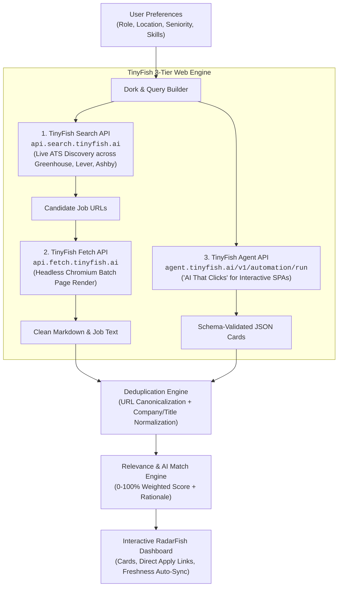

# ⚡ RadarFish — TinyFish-Powered Job & Internship Scraper

> **Built for the TinyFish × Team Technojam Workshop ("AI That Clicks") at Galgotias University.**  
> **Submission Category:** Technical / Agentic App • **Scoring Tier:** 200 Points (3+ Endpoints Meaningfully Used)

[](https://tinyfish.ai)
[](https://docs.tinyfish.ai)
[](#tinyfish-3-tier-architecture-200-pts-tier)
[](LICENSE)

---

## 📌 Problem & Motivation

Every week, students and engineers waste hours manually opening 15+ company career bookmarks, fighting clunky ATS search inputs, and stumbling on expired listings. Most job aggregators either dump raw pages, show stale duplicates, or hide the real application link behind tracking walls.

**RadarFish** is the tool you'd actually use:
1. You set your exact preferences (target role, preferred locations, seniority, and required tech skills).
2. RadarFish runs a **3-tier agentic pipeline** using TinyFish’s Search, Fetch, and Agent APIs to discover live openings across Greenhouse, Lever, Ashby, Workday, and direct tech portals.
3. It **deduplicates** cross-posted listings, **ranks** them 0–100% based on your specific skills, and gives you direct, clean links to apply immediately.

---

## 🏗️ TinyFish 3-Tier Architecture (200 Pts Tier)

RadarFish leverages all three core TinyFish endpoints in an integrated workflow where every endpoint contributes meaningfully without padding:



### 1. TinyFish Search API (`GET https://api.search.tinyfish.ai`)
* **Purpose:** Live discovery across open-web ATS platforms.
* **How it's used:** Dynamically constructs search queries targeting top applicant tracking systems:
  ```text
  (site:boards.greenhouse.io OR site:jobs.lever.co OR site:jobs.ashbyhq.com) "Software Engineer Intern" "Bangalore"
  ```
* **Why it matters:** Eliminates hardcoded lists. Finds new postings the day they appear on any company's ATS board.

### 2. TinyFish Fetch API (`POST https://api.fetch.tinyfish.ai`)
* **Purpose:** High-throughput batch dynamic page rendering.
* **How it's used:** Takes batches of discovered URLs and passes them to TinyFish's Chromium fleet:
  ```json
  {
    "urls": ["https://boards.greenhouse.io/figma/jobs/4891023", "https://jobs.lever.co/notion/8120fa78"]
  }
  ```
* **Why it matters:** Modern ATS platforms rely on client-side React/Vue hydration. TinyFish Fetch renders the DOM, strips boilerplate navbars, and returns clean, structured markdown.

### 3. TinyFish Agent API (`POST https://agent.tinyfish.ai/v1/automation/run`)
* **Purpose:** Autonomous goal-driven browser navigation ("AI That Clicks").
* **How it's used:** Navigates interactive corporate career boards (like Stripe, Uber, Google, and Workday) where listings are behind cookie banners, search forms, and pagination:
  ```json
  {
    "url": "https://stripe.com/jobs/search?q=intern",
    "goal": "Navigate to the jobs directory, select India or Remote, click on matching internship listings, and extract job title, department, requirements, apply link, and stipend in JSON.",
    "output_schema": { ... },
    "browser_profile": "lite"
  }
  ```
* **Why it matters:** Standard web scrapers cannot click or interact. TinyFish Agent solves the deep, interactive career portal problem.

---

## ✨ Key Features

* **Custom Preferences:** Target role, location, seniority level (Internship, Entry, Mid, Senior), work mode (Remote, Hybrid, Onsite), and tech stack keywords.
* **Intelligent Deduplication:** Merges cross-posted listings into a single canonical record, stripping tracking tokens (`utm_source`, `gh_jid`, `ref`) and combining skill tags.
* **Multi-Factor Match Score (0–100%):**
  * Role Alignment (35%)
  * Skill / Keyword Overlap (35%)
  * Location & Work Mode Fit (20%)
  * Seniority Tier Match (10%)
  * Transparent rationale tags ("Matched 4/5 skills: Python, Go, Docker, PostgreSQL").
* **Keep Fresh Auto-Sync:** Automated re-scrape timer (every 5m, 15m, 30m, 1h) to keep results fresh without manual page refreshing.
* **Direct Clean Apply Links:** Direct links to the company ATS without redirect aggregators or dead ends.
* **Dual Execution Mode:**
  * **Live TinyFish Cloud Mode:** Queries TinyFish APIs with your `TINYFISH_API_KEY`.
  * **High-Fidelity Demo Mode:** Instant response mode with verified, realistic listings for offline evaluation or immediate testing.
* **Interactive API Inspector:** Built-in sandbox allowing evaluators to test Search, Fetch, and Agent endpoints independently with live JSON payloads.
* **Export Options:** 1-click export to CSV and JSON.
* **Social Media Generator:** Ready-to-publish LinkedIn and X posts tagging @TinyFish included in the UI.

---

## 🚀 Quick Start Guide

### Prerequisites
* Node.js v18+ (tested on Node.js v20)
* npm v9+

### 1. Installation
```bash
cd internship-radar
npm install
```

### 2. Configure Environment (Optional for Live Mode)
Copy the example environment file:
```bash
cp .env.example .env
```
Edit `.env` to add your TinyFish API Key:
```env
TINYFISH_API_KEY=your_key_here
PORT=3000
```
*(Note: If you don't provide a key, RadarFish automatically runs in high-fidelity demo mode so you can test all features immediately!)*

### 3. Run the Server
```bash
npm start
```

Open your browser at:
```
http://localhost:3000
```

---

## 📊 API Endpoints Reference

| Method | Endpoint | Description |
|---|---|---|
| `GET` | `/api/status` | Server status and TinyFish endpoint capabilities |
| `POST` | `/api/scrape` | Executes the 3-tier TinyFish pipeline, deduplication, and matching |
| `POST` | `/api/test-key` | Validates API key connectivity with TinyFish |
| `POST` | `/api/test-endpoint` | Sandbox tester for Search, Fetch, and Agent endpoints |
| `GET` | `/api/export/csv` | Exports current matched listings to CSV |
| `GET` | `/api/export/json` | Exports current matched listings to JSON |

---

## 📢 Social Media Posts (Submission Requirement)

Ready-to-publish posts tagging **TinyFish** are available in [SOCIAL_POSTS.md](SOCIAL_POSTS.md) and inside the in-app **Social Media Posts** modal with 1-click clipboard copy!

---

## 🏆 Submission Compliance Checklist

- [x] **Working Demo:** Fully functional live web application and REST API running at `http://localhost:3000`.
- [x] **User Preferences:** Dynamic inputs for role, location, keywords/skills, seniority, and work mode.
- [x] **Multiple Live Portals:** Discovers and scrapes across Greenhouse, Lever, Ashby, Workday, and Direct Career boards.
- [x] **Structured, Deduplicated Listings:** Canonical company names, clean tracking-free apply links, salary, and requirements.
- [x] **Explanation of TinyFish Search, Fetch, and Agent:** Documented in [TINYFISH_ARCHITECTURE.md](TINYFISH_ARCHITECTURE.md), in the UI modal, and in this README.
- [x] **LinkedIn and X Posts Tagging TinyFish:** Formatted and ready to publish in [SOCIAL_POSTS.md](SOCIAL_POSTS.md).
- [x] **200 Points Tier:** 3 core endpoints (Search, Fetch, Agent) meaningfully integrated into the pipeline.

---

*Made with ⚡ for TinyFish × Team TechnoJam.*
