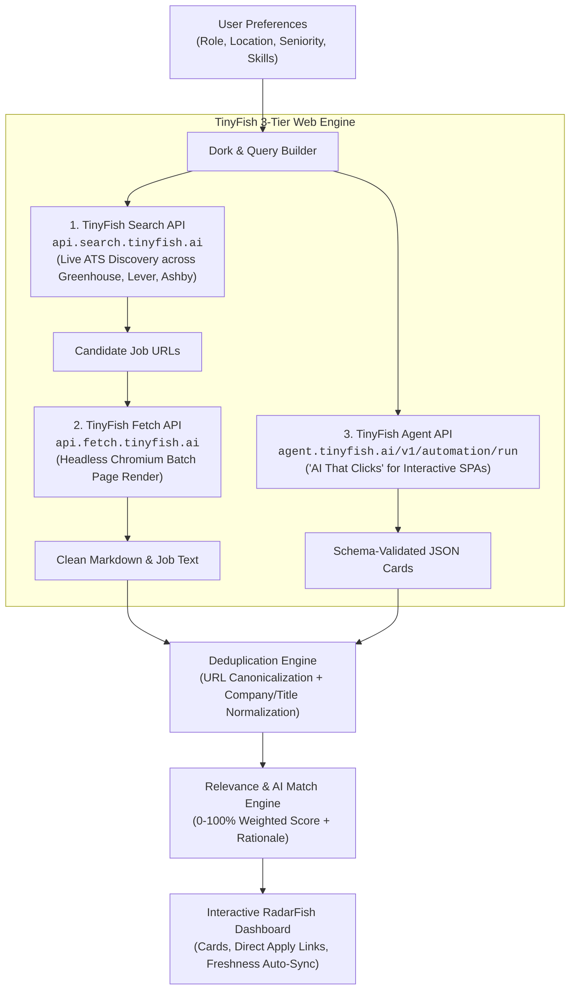

# ⚡ RadarFish Architecture: TinyFish 3-Tier Integration (200 Pts Tier)

RadarFish is an agentic job and internship scraper engineered for the **TinyFish × Team Technojam Workshop** ("AI That Clicks") at Galgotias University.

Instead of scraping static pages or relying on stale aggregated databases, RadarFish leverages all three core TinyFish endpoints in an integrated, multi-stage agentic pipeline:



---

## The 3 Endpoints & Their Specific Contributions

### 1. TinyFish Search API (`GET https://api.search.tinyfish.ai`)
* **Role:** Dynamic Discovery across ATS Portals and Company Career Boards.
* **Why it matters:** Careers pages change URLs constantly. Hardcoding a static list of 10 company career links means the scraper goes stale in days. TinyFish Search runs live queries targeting Applicant Tracking Systems (e.g. `site:boards.greenhouse.io OR site:jobs.lever.co OR site:jobs.ashbyhq.com`) paired with the user's role and location filters.
* **Parameters Used:**
  * `query`: Dynamic ATS operator string (e.g., `(site:boards.greenhouse.io OR site:jobs.lever.co) "Software Engineer Intern" "Bangalore"`)
  * `location`: Regional targeting (e.g., `"IN"` or `"US"`)
  * `recency_minutes`: Freshness filter to capture newly posted listings
* **Header:** `X-API-Key: $TINYFISH_API_KEY`

### 2. TinyFish Fetch API (`POST https://api.fetch.tinyfish.ai`)
* **Role:** High-Throughput Batch Dynamic Rendering.
* **Why it matters:** Modern ATS boards (especially Greenhouse and Ashby) are heavy client-side JavaScript applications that fail with standard HTTP `GET` requests (returning empty `<div id="root"></div>` tags or triggering Cloudflare captchas). TinyFish Fetch renders candidate URLs in a managed Chromium fleet, strips navigation boilerplates and script artifacts, and extracts pristine markdown job descriptions, qualifications, and direct application links.
* **Request Payload:**
  ```json
  {
    "urls": [
      "https://boards.greenhouse.io/figma/jobs/4891023",
      "https://jobs.lever.co/notion/8120fa78-3a9b-4cd1-a4b5"
    ]
  }
  ```

### 3. TinyFish Agent API (`POST https://agent.tinyfish.ai/v1/automation/run`)
* **Role:** Autonomous Goal-Driven Browser Automation ("AI That Clicks").
* **Why it matters:** Direct company career hubs (such as Stripe, Uber, Microsoft, Google, or Workday portals) do not expose clean static pages. They require interactive user journeys: clicking cookie consent dialogs, navigating search dropdowns, selecting "University / Internships" checkboxes, and clicking modal overlays to inspect requirements. The TinyFish Agent accepts natural-language goals and an optional JSON `output_schema`, executes the browser interactions autonomously, and returns structured data.
* **Request Payload:**
  ```json
  {
    "url": "https://stripe.com/jobs/search?q=intern",
    "goal": "Navigate to the jobs directory, select India or Remote, click on matching internship listings, and extract job title, department, requirements, apply link, and stipend in JSON.",
    "output_schema": {
      "type": "object",
      "properties": {
        "jobs": {
          "type": "array",
          "items": {
            "type": "object",
            "properties": {
              "title": { "type": "string" },
              "location": { "type": "string" },
              "apply_url": { "type": "string" },
              "requirements": { "type": "array", "items": { "type": "string" } }
            }
          }
        }
      }
    },
    "browser_profile": "lite"
  }
  ```

---

## 4. Deduplication Engine

Cross-posted listings (e.g., a company listing the same role on both Greenhouse and their primary website, or aggregators indexing duplicate URLs with different UTM parameters) clutter normal search tools.

RadarFish's Deduplication Engine:
1. **Normalizes Company Names:** Strips corporate suffixes (`Inc.`, `LLC`, `Pvt Ltd`, `Technologies`).
2. **Normalizes Titles:** Removes ATS brackets, seasonal tags, and noise (`[Hiring]`, `(Summer 2026)`, `(Batch 2026)`).
3. **Canonicalizes URLs:** Strips tracking tokens (`utm_source`, `gh_jid`, `ref`, `tracking_id`, hash fragments).
4. **Intelligent Merging:** Merges duplicates, preserves the richest description and requirements, combines skills, and tags all originating portals.

---

## 5. Intelligent Match & Relevance Engine (0–100%)

Rather than dumping raw text, RadarFish scores each job against the user's explicit profile:
* **Role Alignment (35%):** Exact keyword matches + semantic synonym expansion (e.g., matching "UI / React" for "Frontend Developer").
* **Skills Overlap (35%):** Compares requested technologies (Python, Go, Docker, React, PyTorch) with extracted descriptions, highlighting matched skills in green.
* **Location & Work Mode (20%):** Matches specific cities (Bangalore, Noida, SF) or Remote preferences.
* **Seniority Fit (10%):** Validates internship or entry-level tier.
* **Transparent Breakdown:** Provides human-readable rationale ("Strong match for Software Engineer Intern", "Matches 4/5 skills: Python, Go, PostgreSQL", "Matches Hybrid preference").
